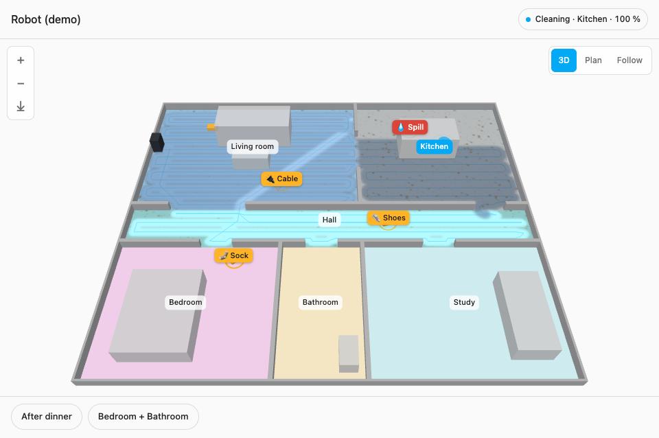

# Dreame Vacuum 3D for Home Assistant

[](https://github.com/hacs/integration)
[](https://github.com/dortizesquivel/dreame-vacuum-3d/releases)
[](https://github.com/dortizesquivel/dreame-vacuum-3d/releases)
[](https://github.com/dortizesquivel/dreame-vacuum-3d/actions/workflows/ci.yml)
[](https://github.com/dortizesquivel/dreame-vacuum-3d/actions/workflows/validate.yml)
[](https://github.com/dortizesquivel/dreame-vacuum-3d/actions/workflows/codeql.yml)
[](https://scorecard.dev/viewer/?uri=github.com/dortizesquivel/dreame-vacuum-3d)
[](LICENSE)
[](https://www.home-assistant.io/)

A Home Assistant integration for Dreame robot vacuums: local miIO control, Xiaomi cloud login for maps and fallback, Tasshack-compatible cleaning services, a capability table per model, and a 3D card that draws the robot moving through a 3D model of your house.

[](https://dortizesquivel.github.io/dreame-vacuum-3d/)

**[Try the live demo](https://dortizesquivel.github.io/dreame-vacuum-3d/)** on the project's page: the card with a simulated robot, in an example living room or a six-room flat.

**Contents:** [Requirements](#requirements) · [Installation](#installation) · [Configuration](#configuration) · [The 3D card](#the-3d-card) · [Models](#models) · [Services](#services) · [Events](#events) · [Options](#options) · [Development](#development) · [Credits](#credits) · [License](#license)

## Requirements

- **Home Assistant 2026.10 or newer.**
- **[HACS](https://hacs.xyz/)**, to install and update it (or [install manually](#manual)).
- A **Dreame** vacuum on a **Xiaomi Home** account (same credentials as the Xiaomi/Mi Home app).
- Local network access to the robot (UDP miIO on port 54321).

## Installation

### Via HACS (recommended)

1. In Home Assistant, open **HACS** → the three-dot menu → **Custom repositories**.
2. Add `https://github.com/dortizesquivel/dreame-vacuum-3d` as category **Integration**.
3. Search for **Dreame Vacuum 3D**, download it and restart Home Assistant.

Or open it in HACS on your own Home Assistant with this button, then select **Download** and restart:

[](https://my.home-assistant.io/redirect/hacs_repository/?owner=dortizesquivel&repository=dreame-vacuum-3d&category=integration)

**Updates:** new versions show up in HACS and under **Settings → Updates**.

### Manual

1. Download `dreame_vacuum_3d.zip` from the [latest release](https://github.com/dortizesquivel/dreame-vacuum-3d/releases/latest).
2. Extract it into `/config/custom_components/dreame_vacuum_3d/`, so that `manifest.json` ends up at `/config/custom_components/dreame_vacuum_3d/manifest.json`.
3. Restart Home Assistant.

## Configuration

1. Go to **Settings → Devices & services → + Add integration**.
2. Search for **Dreame Vacuum 3D**.
3. Sign in with your Xiaomi Home email/ID, password and server country. Complete captcha or two-factor verification if asked.
4. Pick the Dreame vacuum from the list.

The entry stores the local IP, token, cloud session and account password (needed to renew the session). See [ASSURANCE](docs/ASSURANCE.md) for what is kept and how diagnostics redact it.

If you still run [Tasshack/dreame-vacuum](https://github.com/Tasshack/dreame-vacuum) or another Dreame integration on the same robot, leave **Coexist** enabled (the default) so this integration polls more slowly while docked.

## The 3D card

The integration serves the card itself: after installing it, edit a dashboard, select **Add card** and search for **Dreame Vacuum 3D Card**, or in YAML:

```yaml
type: custom:dreame-vacuum-3d-card
entity: vacuum.xiaomi_robot_vacuum_x10
model:                              # optional: a 3D model of your house
  url: /local/house.glb
  dock: { position: [4.2, 0, 3.1], heading: 180 }
```

The robot moves on the card as it cleans, with its path, the rooms it is cleaning and the room it is in. Where it vacuums, the dust on those rooms clears and the floor glints for a moment, while specks fly into the robot; where it mops, the floor turns dark and glossy and dries out over `dry_time` minutes (default 10). Tap a room to clean it, or with the zone button drag a rectangle on the floor to clean just that; the history button lists the last cleanings, plays one back on the map (×20) and shows the coverage of the last five (stronger where more of them went); the buttons by the status start or pause the robot and send it back to the dock. A tag over the robot says what it is doing when it isn't plain cleaning (washing or drying its mops, emptying its bin, charging, paused, an error, in Home Assistant's language), its side brushes spin while it vacuums and its mop pads show while it mops; where it gets stuck stays marked, with why, until the next cleaning. **3D**, **Plan** and **Follow** change the view; pinch, Ctrl/⌘ + wheel or **+**/**−** zoom.

- **The house.** Without `model`, the card draws the robot's own map: rooms in colours, walls and the dock. With `model`, it draws your 3D model (glTF/GLB) and puts the robot on it: `model.dock.position` is the point of the model's floor under the docked robot (metres, y up) and `model.dock.heading` the way the docked robot faces (degrees: 0 = the model's +z, 90 = +x). `style: futuristic` draws the model as a hologram; `units` (`m`, `cm`, `mm`, `in`, `ft`), `up` (`y` or `z`) and `opacity` are as in the [mmWave 3D Card](https://github.com/dortizesquivel/mmwave-3d-card#a-3d-model-of-your-room).
- **What the robot finds.** Obstacles its camera or lidar reports (shoes, socks, cables, pet waste, spills…) appear where it found them, named in Home Assistant's language. What the lidar sees on floor that was open when the house was mapped shows as low blocks with its outline: the robot gives the outline, not the height. Furniture the robot recognised is drawn as boxes when there is no model.
- **Make a model from photos.** [docs/house-model.md](docs/house-model.md) is a prompt for an AI coding agent that turns phone photos of each room into a model of the house, built on the robot's floor plan (**⤓** on the card downloads it), with the `model:` config ready.
- **Routines.** Buttons under the map that clean several rooms in one go, by the names the robot gives them or by number, with optional `suction_level` (0–3), `water_volume` (1–3) and `repeats`, as in `vacuum_clean_segment`:

  ```yaml
  routines:
    - name: After dinner
      rooms: [Kitchen, Living room]
      suction_level: 2
    - rooms: [Bedroom, Bathroom]     # without a name, the button shows the rooms
  ```

- **Other options.** `title`, `height` (pixels, default 420), `view` (`3d` or `plan`), `labels` (room names, default on), `dry_time` (minutes the mopped floor takes to dry, default 10) and `effects` (the dust and wet floor, default on: `false` hides both, `{ dust: false }` or `{ wet: false }` one). The card stops drawing while it is off screen and lets go of its WebGL context when it leaves the page.
- **Where the map comes from.** While the robot cleans it logs a map frame in the Xiaomi cloud every 2–3 seconds; the integration reads the new ones every 2.5 seconds while a card shows the map (every 5 seconds otherwise) and sends the card the robot's pose, the path's new points, the rooms being cleaned and what the robot found. While the robot is docked it asks for a whole frame every 15 minutes (every 30 seconds until the first one comes). So the map needs the cloud; commands don't.

Entities come from the map and the history too: **Current room**, **Last cleaning** (with its duration, area and rooms), and per room a **Clean *room*** button and a ***room* last cleaned** sensor (with how many times in the last week). The history is the robot's own, from the Xiaomi cloud: the integration reads it shortly after it starts and after each cleaning (a minute later, and again at 10 and 30 minutes, since the cloud can be slow to get it).

Without a model, the card draws the robot's own map:



To run the demo locally: `cd card && npm install && npm run build && npm run demo`, then open <http://127.0.0.1:8792/card/demo/> (`?house=flat` for the flat). Its houses are in `card/demo/houses/`, made by `node demo/make-houses.mjs`; `?house=PATH/` loads another folder with a `map.json` (a map from Tasshack's integration) and a `config.json` like theirs.

## Models

Capabilities come from YAML under `custom_components/dreame_vacuum_3d/device/models/`. A model with no dedicated file inherits the untested family base.

| Model ID | Name | Status |
|---|---|---|
| `dreame.vacuum.p2114a` | Xiaomi Robot Vacuum X10+ | **Tested** |
| Other Dreame vacuums | Family base (`dreame_base`) | **Untested** — entities appear only for properties the robot returns |

To help add a model, download diagnostics from the device page and open an issue or PR: see [CONTRIBUTING.md](CONTRIBUTING.md).

## Services

Entity services under domain `dreame_vacuum_3d` (names match Tasshack for Node-RED migration: `dreame_vacuum.*` → `dreame_vacuum_3d.*`). Target a `vacuum` entity from this integration.

| Service | Purpose |
|---|---|
| `vacuum_clean_segment` | Clean room segment(s); optional repeats, suction, water |
| `vacuum_clean_zone` | Clean zone rectangle(s) |
| `vacuum_clean_spot` | Spot-clean at point(s) |
| `vacuum_goto` | Go to coordinates (mm) |
| `vacuum_remote_control_move_step` | One remote-control step |
| `vacuum_select_map` | Select map / floor by `map_id` |
| `vacuum_reset_consumable` | Reset a consumable life counter |

Without `suction_level` or `water_volume`, the cleaning services use the robot's current settings, as the app does.

Map-edit services (restricted zones, merge/split/rename segments) are planned for a later phase.

## Events

Fired on the Home Assistant bus (payload always includes `entity_id` and `device_id`):

| Event | When |
|---|---|
| `dreame_vacuum_3d_task_status` | A cleaning task ends: `completed`, `area`, `duration`, and `segments` when this integration started a room clean |
| `dreame_vacuum_3d_consumable` | A consumable drops to or below the warning threshold |
| `dreame_vacuum_3d_error` | Robot reports an error |
| `dreame_vacuum_3d_information` | Warnings / informational codes (low water, paused, etc.) |

Persistent notifications can be enabled per category in the options. They are written in Home Assistant's language (English and Spanish so far).

## Options

From the integration's **Configure** button:

| Option | Description | Default |
|---|---|---|
| Coexist | Slower docked polling while another Dreame integration is installed | on |
| Notification categories | Persistent notifications for cleanup completed, consumables, information, warnings, errors | as configured |
| Consumable warning threshold | Remaining % that triggers a consumable event/notification | 15 |

Reconfigure the local IP if the robot's address changed. When the cloud session expires, the integration logs in again with the saved password; it asks you to reauthenticate only when Xiaomi wants a captcha or a verification code.

## Development

```bash
python3 -m venv .venv && . .venv/bin/activate
pip install -r requirements_test.txt
ruff check .
ruff format --check .
mypy
python scripts/check_translations.py
pytest
cd card && npm ci && npm run lint && npm test && npm run build   # the card; commit the rebuilt bundle with its source
npx playwright install chromium && npm run test:browser   # the card in the demo, in a browser
```

`main` is protected: changes go in through a pull request. Required checks are **Python tests** (ruff, formatting, mypy, translations, pytest with a 95 % coverage floor) and **Validate** (HACS + hassfest); see [CONTRIBUTING.md](CONTRIBUTING.md).

Layout: [docs/ARCHITECTURE.md](docs/ARCHITECTURE.md). Security model: [docs/ASSURANCE.md](docs/ASSURANCE.md) and [SECURITY.md](SECURITY.md). Who decides what: [GOVERNANCE.md](GOVERNANCE.md); what comes next: [ROADMAP.md](ROADMAP.md).

### Releasing

```bash
gh workflow run release.yml -f bump=patch
gh workflow run release.yml -f bump=minor -f dry_run=true
```

The [Release workflow](.github/workflows/release.yml) bumps `manifest.json`, updates [`CHANGELOG.md`](CHANGELOG.md), tags and publishes `dreame_vacuum_3d.zip` with a signed build-provenance attestation.

## Credits

This integration ports protocol knowledge, property maps and service names from **[Tasshack/dreame-vacuum](https://github.com/Tasshack/dreame-vacuum)** (MIT). See [NOTICE](NOTICE) for the upstream copyright. Dreame Vacuum 3D is an independent project and is not affiliated with Tasshack, Dreame or Xiaomi.

## License

[MIT](LICENSE). Portions derived from Tasshack/dreame-vacuum remain under MIT as stated in [NOTICE](NOTICE).
